<picture>
  <source media="(max-width: 600px)" srcset="./assets/hero-narrow.svg">
  
</picture>

<b><a href="https://github.com/guisba/guisba/issues/new?title=Hello%2C%20Guilherme&body=Who%20I%20am%3A%0A%0AWhat%20I%27d%20like%20to%20talk%20about%3A%0A">Say&nbsp;hello</a></b> &nbsp;·&nbsp; Projects: <a href="https://github.com/guisba/DataBreaker">DataBreaker</a>, <a href="https://github.com/guisba/Listed">Listed</a> &nbsp;·&nbsp; <a href="./README.pt-BR.md">Leia&nbsp;em&nbsp;português</a>

I'm Guilherme, based in São Paulo. I study cybersecurity, explore AI and follow economics closely. I offer security testing and software development, and I'm open to work and to conversations.

<picture>
  <source media="(max-width: 600px)" srcset="./assets/toolbox-narrow.svg">
  
</picture>

<picture>
  <source media="(max-width: 600px)" srcset="./assets/head-activity-narrow.svg">
  
</picture>

  
  

  

  

<!-- BLOG-POST-LIST:START -->
<!-- BLOG-POST-LIST:END -->

