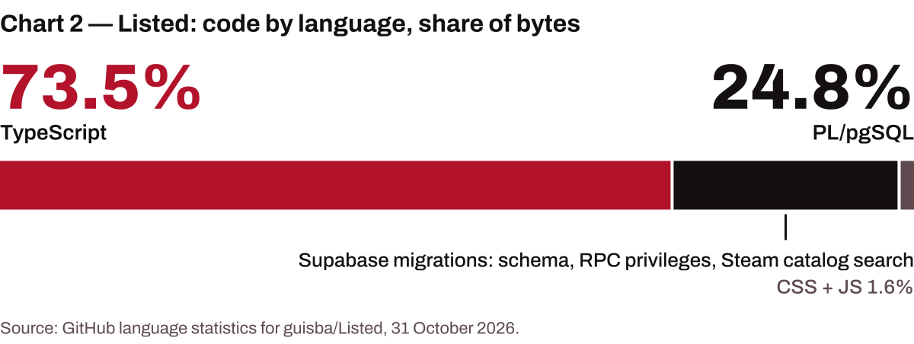

<picture>
  <source media="(max-width: 600px)" srcset="./assets/cover-narrow.svg">
  
</picture>

**[Say&nbsp;hello](https://github.com/guisba/guisba/issues/new?title=Hello%2C%20Guilherme&body=Who%20I%20am%3A%0A%0AWhat%20I%27d%20like%20to%20talk%20about%3A%0A)** &nbsp;·&nbsp; [Try&nbsp;DataBreaker](https://databreaker-ashy.vercel.app/) &nbsp;·&nbsp; [Leia&nbsp;em&nbsp;português](./README.pt-BR.md)

## Summary

I'm Guilherme Sabatini, a student in São Paulo. I study cybersecurity, explore AI, am working through CS50, and follow economics closely. I learn by building, and this page reports what that has produced so far: two public projects, how they work, and what comes next. I wrote it to meet people who work in these fields.

## 1 · Position

**Table 1 — Position**

<table><tr><th align="left">Cybersecurity</th><td>Studying</td></tr><tr><th align="left">Artificial intelligence</th><td>Exploring</td></tr><tr><th align="left">CS50</th><td>In progress</td></tr><tr><th align="left">Economics</th><td>A standing interest</td></tr><tr><th align="left">Based in</th><td>São Paulo, Brazil</td></tr><tr><th align="left">Availability</th><td>Open to work and to conversations</td></tr></table>

Source: GitHub profile (location, open to work), 31 October 2026; the author.

## 2 · Projects

### Box 1 — [DataBreaker](https://github.com/guisba/DataBreaker)

**What can a file reveal about where it came from?** DataBreaker answers that before you share it. It inspects ordinary metadata, custom blocks, origin fingerprints, AI-workflow traces (C2PA / Content Credentials, Stable Diffusion and ComfyUI parameters) and cryptographic provenance. It explains what it finds, cleans what it can rewrite safely, then reopens and rescans the output instead of trusting a success code.

<picture>
  <source media="(max-width: 600px) and (prefers-color-scheme: dark)" srcset="./assets/chart-databreaker-narrow-dark.svg">
  <source media="(max-width: 600px)" srcset="./assets/chart-databreaker-narrow-light.svg">
  <source media="(prefers-color-scheme: dark)" srcset="./assets/chart-databreaker-dark.svg">
  
</picture>

It runs ExifTool 13.59 in the browser through WebAssembly, so file contents are not uploaded to a DataBreaker backend, and it sends no telemetry. Python and JavaScript, in English and Portuguese. &nbsp;[Live](https://databreaker-ashy.vercel.app/) · [Docs](https://caveras-personal-organization.gitbook.io/databreaker/) · [Repository](https://github.com/guisba/DataBreaker)

### Box 2 — [Listed](https://github.com/guisba/Listed)

**Shared game lists for groups deciding what to play.** Temporary sessions with short invite codes, real-time rooms, voting, Steam discovery, combined filters, and random or weighted picks. Built with Next.js 16, React 19 and Supabase (Auth, Realtime, PostgreSQL), in English and Portuguese.

<picture>
  <source media="(max-width: 600px) and (prefers-color-scheme: dark)" srcset="./assets/chart-listed-narrow-dark.svg">
  <source media="(max-width: 600px)" srcset="./assets/chart-listed-narrow-light.svg">
  <source media="(prefers-color-scheme: dark)" srcset="./assets/chart-listed-dark.svg">
  
</picture>

About a quarter of the code is PostgreSQL migrations (schema, RPC privileges, the Steam catalog search), and persistence is protected by row-level security. &nbsp;[Repository](https://github.com/guisba/Listed)

## 3 · Method

Four rules from these projects, each checkable in the repositories:

1. **Verify the result.** DataBreaker validates its own output with a second scan and a before/after diff.
2. **Claim only what holds.** It "does not promise universal metadata removal" and says so on its front page.
3. **Keep data where it belongs.** No analytics, no behavioural telemetry; the local and browser editions do not upload file contents to a DataBreaker backend.
4. **Write for two languages.** Both projects ship in English and Brazilian Portuguese.

## 4 · Outlook

Finishing CS50, going deeper into security, and building more with AI, with economics as the lens I keep coming back to. If you work in any of these, I'd like to hear from you.

**[Say&nbsp;hello](https://github.com/guisba/guisba/issues/new?title=Hello%2C%20Guilherme&body=Who%20I%20am%3A%0A%0AWhat%20I%27d%20like%20to%20talk%20about%3A%0A)** opens an issue here, with a short template.

Data as of 31 October 2026. Sources: GitHub public API and each repository's README. Set in Archivo (SIL Open Font License).
