<picture>
  <source media="(max-width: 600px)" srcset="./assets/hero-pt-narrow.svg">
  
</picture>

<b><a href="https://github.com/guisba/guisba/issues/new?title=Ol%C3%A1%2C%20Guilherme&body=Quem%20sou%3A%0A%0ASobre%20o%20que%20quero%20conversar%3A%0A">Diga&nbsp;olá</a></b> &nbsp;·&nbsp; Projetos: <a href="https://github.com/guisba/DataBreaker">DataBreaker</a>, <a href="https://github.com/guisba/Listed">Listed</a> &nbsp;·&nbsp; <a href="./README.md">Read&nbsp;in&nbsp;English</a>

Sou o Guilherme, de São Paulo. Estudo cibersegurança, exploro IA e acompanho economia de perto. Ofereço testes de segurança e desenvolvimento de software, e estou aberto a trabalho e a conversas.

<picture>
  <source media="(max-width: 600px)" srcset="./assets/toolbox-pt-narrow.svg">
  
</picture>

<picture>
  <source media="(max-width: 600px)" srcset="./assets/head-activity-pt-narrow.svg">
  
</picture>

  
  

  

  

<!-- BLOG-POST-LIST:START -->
<!-- BLOG-POST-LIST:END -->

