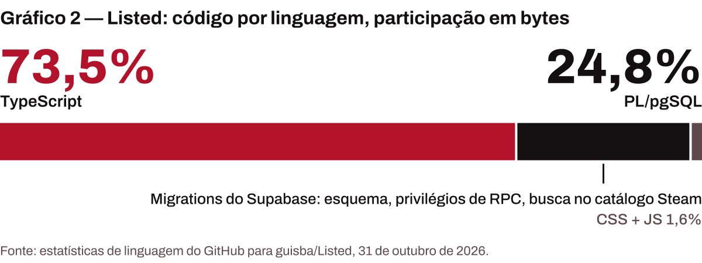

<picture>
  <source media="(max-width: 600px)" srcset="./assets/cover-pt-narrow.svg">
  
</picture>

**[Diga&nbsp;olá](https://github.com/guisba/guisba/issues/new?title=Ol%C3%A1%2C%20Guilherme&body=Quem%20sou%3A%0A%0ASobre%20o%20que%20quero%20conversar%3A%0A)** &nbsp;·&nbsp; [Experimente&nbsp;o&nbsp;DataBreaker](https://databreaker-ashy.vercel.app/) &nbsp;·&nbsp; [Read&nbsp;in&nbsp;English](./README.md)

## Resumo

Sou Guilherme Sabatini, estudante em São Paulo. Estudo cibersegurança, exploro IA, estou fazendo o CS50 e acompanho economia de perto. Aprendo construindo, e esta página relata o que isso produziu até aqui: dois projetos públicos, como funcionam e o que vem a seguir. Escrevi para conhecer quem trabalha nessas áreas.

## 1 · Posição

**Tabela 1 — Posição**

<table><tr><th align="left">Cibersegurança</th><td>Estudando</td></tr><tr><th align="left">Inteligência artificial</th><td>Explorando</td></tr><tr><th align="left">CS50</th><td>Em andamento</td></tr><tr><th align="left">Economia</th><td>Interesse permanente</td></tr><tr><th align="left">Base</th><td>São Paulo, Brasil</td></tr><tr><th align="left">Disponibilidade</th><td>Aberto a trabalho e a conversas</td></tr></table>

Fonte: perfil no GitHub (localização, disponível para contratação), 31 de outubro de 2026; o autor.

## 2 · Projetos

### Boxe 1 — [DataBreaker](https://github.com/guisba/DataBreaker)

**O que um arquivo revela sobre a própria origem?** O DataBreaker responde isso antes de você compartilhar o arquivo. Ele inspeciona metadados comuns, blocos customizados, impressões de origem, rastros de fluxos de IA (C2PA / Content Credentials, parâmetros de Stable Diffusion e ComfyUI) e proveniência criptográfica. Explica o que encontra, limpa o que pode reescrever com segurança e depois reabre e reanalisa o resultado, em vez de confiar num código de sucesso.

<picture>
  <source media="(max-width: 600px) and (prefers-color-scheme: dark)" srcset="./assets/chart-databreaker-pt-narrow-dark.svg">
  <source media="(max-width: 600px)" srcset="./assets/chart-databreaker-pt-narrow-light.svg">
  <source media="(prefers-color-scheme: dark)" srcset="./assets/chart-databreaker-pt-dark.svg">
  
</picture>

Roda o ExifTool 13.59 no navegador via WebAssembly, então o conteúdo dos arquivos não vai para um backend do DataBreaker, e não envia telemetria. Python e JavaScript, em português e inglês. &nbsp;[Online](https://databreaker-ashy.vercel.app/) · [Documentação](https://caveras-personal-organization.gitbook.io/databreaker/) · [Repositório](https://github.com/guisba/DataBreaker)

### Boxe 2 — [Listed](https://github.com/guisba/Listed)

**Listas de jogos compartilhadas para grupos decidirem o que jogar.** Sessões temporárias com códigos curtos de convite, salas em tempo real, votação, descoberta na Steam, filtros combinados e sorteios aleatórios ou ponderados. Feito com Next.js 16, React 19 e Supabase (Auth, Realtime, PostgreSQL), em português e inglês.

<picture>
  <source media="(max-width: 600px) and (prefers-color-scheme: dark)" srcset="./assets/chart-listed-pt-narrow-dark.svg">
  <source media="(max-width: 600px)" srcset="./assets/chart-listed-pt-narrow-light.svg">
  <source media="(prefers-color-scheme: dark)" srcset="./assets/chart-listed-pt-dark.svg">
  
</picture>

Cerca de um quarto do código são migrations PostgreSQL (esquema, privilégios de RPC, a busca no catálogo da Steam), e a persistência é protegida por row-level security. &nbsp;[Repositório](https://github.com/guisba/Listed)

## 3 · Método

Quatro regras destes projetos, todas verificáveis nos repositórios:

1. **Verificar o resultado.** O DataBreaker valida a própria saída com uma segunda varredura e um diff antes/depois.
2. **Afirmar só o que se sustenta.** Ele "não promete remoção universal de metadados" e diz isso na primeira página.
3. **Manter os dados onde devem estar.** Sem analytics, sem telemetria comportamental; as edições local e de navegador não enviam o conteúdo dos arquivos a um backend do DataBreaker.
4. **Escrever para duas línguas.** Os dois projetos saem em português e inglês.

## 4 · Perspectivas

Terminar o CS50, aprofundar em segurança e construir mais com IA, com a economia como a lente a que sempre volto. Se você trabalha com alguma dessas áreas, quero conversar.

**[Diga&nbsp;olá](https://github.com/guisba/guisba/issues/new?title=Ol%C3%A1%2C%20Guilherme&body=Quem%20sou%3A%0A%0ASobre%20o%20que%20quero%20conversar%3A%0A)** abre uma issue aqui, com um modelo curto.

Dados de 31 de outubro de 2026. Fontes: API pública do GitHub e o README de cada repositório. Composto em Archivo (SIL Open Font License).
